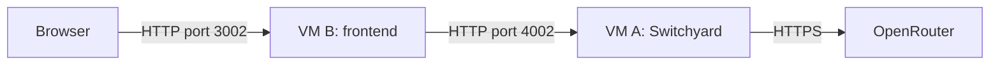

# Single-host and split-VM deployment

The same gateway and frontend images support both layouts. Run commands from
this `nemo-switchyard/` directory on each host. You need Docker Engine and the
Docker Compose v2 plugin. Building locally also needs access to the base-image
registry and PyPI. The gateway needs outbound access to OpenRouter.

| Layout | Compose file | Services | Required environment |
| --- | --- | --- | --- |
| One host | `docker-compose.yaml` | Gateway + frontend | OPENROUTER_API_KEY |
| Gateway VM | `docker-compose.gateway.yaml` | Gateway only | OPENROUTER_API_KEY |
| Frontend VM | `docker-compose.frontend.yaml` | Frontend only | SWITCHYARD_URL |

All published ports continue to bind to `0.0.0.0` for the protected lab. Separate
Compose project names isolate the standalone deployments from the full stack.
Do not run layouts using the same published ports on one VM at the same time.

## One host

Use the existing `.env` or create it from `.env.example` on a fresh checkout.
Keep the provider key private. With no override, the frontend reaches the
container's internal gateway URL, `http://switchyard:4000`.

```bash
# Fresh checkout only:
cp .env.example .env
chmod 600 .env
# Set OPENROUTER_API_KEY in .env, then:
docker compose up -d --build --wait
```

Open `http://<host-ip>:3002`. The gateway API is `http://<host-ip>:4002/v1`.
Existing installations should retain their `.env`; do not overwrite it.

## Gateway on VM A, frontend on VM B



The browser contacts only the frontend. Its server proxies API requests to the
gateway VM, so CORS configuration and provider credentials in the browser are
not needed. Session IDs continue to be forwarded across the remote HTTP hop.

### VM A: gateway

Place this directory on the gateway VM. On a fresh installation:

```bash
cp gateway.env.example .env.gateway
chmod 600 .env.gateway
# Edit .env.gateway and set OPENROUTER_API_KEY.
docker compose --env-file .env.gateway -f docker-compose.gateway.yaml up -d --build --wait
curl --fail-with-body http://localhost:4002/health
```

This starts only Switchyard. It does not build, start or depend on the frontend.
The public gateway port defaults to 4002; `SWITCHYARD_PORT` changes it.

### VM B: frontend

Place the frontend deployment directory on VM B too. Gateway credentials stay on VM A. VM B uses `.env.frontend` only; it needs no
OpenRouter key or local gateway container.

```bash
cp frontend.env.example .env.frontend
# Edit .env.frontend, for example:
# SWITCHYARD_URL=http://172.16.247.63:4002
# Use VM A's actual address and its published gateway port.
docker compose --env-file .env.frontend -f docker-compose.frontend.yaml up -d --build --wait
curl --fail-with-body http://localhost:3002/api/health
```

Open `http://<frontend-vm-ip>:3002` from another VM or workstation. The URL in
`SWITCHYARD_URL` must be reachable **from the frontend container**. Do not use
`localhost` unless the gateway is inside that same container. Do not use the
single-host Docker DNS name `switchyard` across VMs. Use an IP address or DNS
name routable between the VMs, and include the external port (4002 by default).
Do not append `/v1`; the frontend adds each endpoint path itself. HTTP and HTTPS
are supported; HTTPS must use a certificate trusted by the frontend container.
An optional reverse-proxy base path is supported. URL credentials, query strings
and fragments are rejected to avoid misconfiguration or credential leakage.

The frontend health check confirms that the web server is running. The UI's
connection status and `/api/health` also check the remote gateway. Starting the
frontend does not wait for, start or restart a gateway on another machine.

## Keep route descriptions aligned

Both deployments mount `routes.toml` read-only. The frontend uses a local copy
for its method descriptions and policy display; Switchyard executes its own
copy. Deploy the **same revision** of this file on both VMs. `ROUTES_FILE` can
point to another file on each host (prefer absolute paths for external files).
This design does not synchronize files or fetch configuration from the remote
server automatically.

```bash
# Run on both VMs; hashes should match:
sha256sum routes.toml
```

After route changes, copy/deploy the updated file to both VMs, restart the gateway
and reload the browser. If you change `ROUTES_FILE` or the gateway URL, recreate
the corresponding service so its environment/mount changes take effect.

## Change the remote gateway URL

Edit `.env.frontend`, then:

```bash
docker compose --env-file .env.frontend -f docker-compose.frontend.yaml up -d --force-recreate frontend
```

Each standalone Compose file also supports prebuilt images. Build/push the image
tags into your own registry, replace the `image` reference in the relevant file,
and deploy with `--no-build` after pulling it. The route file still needs to be
present on each VM. No remote VM provisioning or SSH credentials are required
by the frontend application itself.

## Connectivity and troubleshooting

- Allow browser/workstation access to VM B's frontend port (default 3002).
- Allow VM B's container traffic to reach VM A's gateway port (default 4002).
- Allow gateway egress to OpenRouter over HTTPS.
- These lab services have no inbound user authentication; keep access within the
  protected network or place an authenticated TLS reverse proxy in front.

From VM B, test `curl http://<gateway-vm-ip>:4002/health`. Then test from its
frontend container to distinguish host routing from container routing:

```bash
docker compose --env-file .env.frontend -f docker-compose.frontend.yaml exec frontend \
  python -c 'import os,urllib.request; print(urllib.request.urlopen(os.environ["SWITCHYARD_URL"].rstrip("/")+"/health",timeout=5).read().decode())'
```

Check that the gateway is healthy, the IP/port are correct, DNS resolves, and
firewall/network rules allow the connection. A failed remote call is reported
in the UI; it does not silently redirect to a local gateway. Diagnostics do not
require printing or copying the gateway provider key.

## Logs and stop commands

```bash
# Gateway VM:
docker compose --env-file .env.gateway -f docker-compose.gateway.yaml logs --tail=100
docker compose --env-file .env.gateway -f docker-compose.gateway.yaml down
# Frontend VM:
docker compose --env-file .env.frontend -f docker-compose.frontend.yaml logs --tail=100
docker compose --env-file .env.frontend -f docker-compose.frontend.yaml down
# Full stack:
docker compose down
```

When migrating an existing full-stack host, stop that layout before starting a
standalone deployment on the same ports. Gateway restart or migration clears
its in-memory session/continuation state. Browser history is already page-local.
